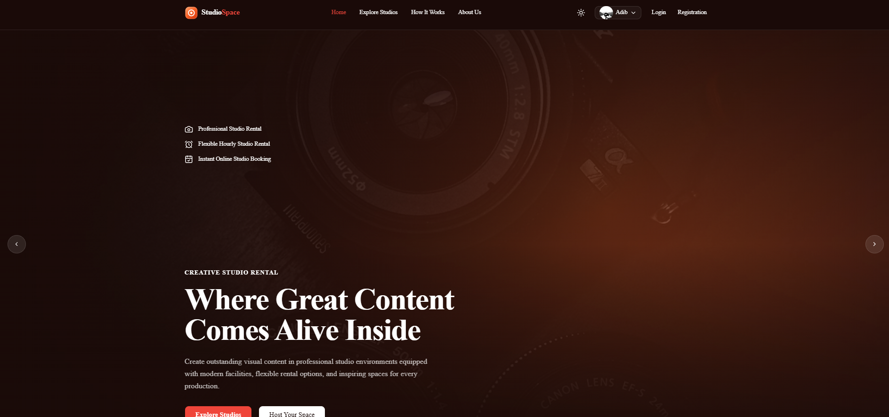

# StudioSpace Frontend And Backend


## 📸 Project Preview

### Homepage



Open [https://studiospace-frontend-three.vercel.app] in your browser to see the application.


## Technologies Used

### Frontend

- **Next.js**
- **React.js**
- **JavaScript**
- **TypeScript**
- **Tailwind CSS**
- **HTML5**
- **CSS3**


## Backend

- **Node.js**
- **Express.js**
- **MongoDB**


## Authentication & Tools

- **Better Auth**
- **Git & GitHub**
- **Vercel**


## Getting Started

```bash
npm install
npm run dev
```


## Scripts

| Command | Description |
|---|---|
| `npm run dev` | Start dev server (Turbopack, port 3000) |
| `npm run build` | Production build (also runs TypeScript) |
| `npm start` | Start production server |
| `npm run lint` | Run ESLint |


## Structure

```
src/
├── app/            # App Router routes, layout, global CSS
├── components/
│   ├── ui/         # shadcn / Base UI primitives
│   └── ...         # app components (site header, etc.)
├── hooks/          # client hooks
└── lib/            # cn re-export, Shiki highlighter
```
